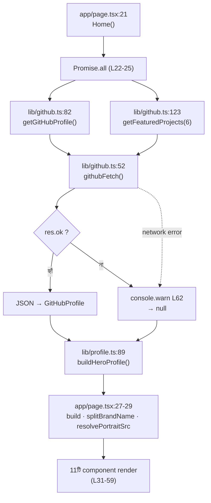
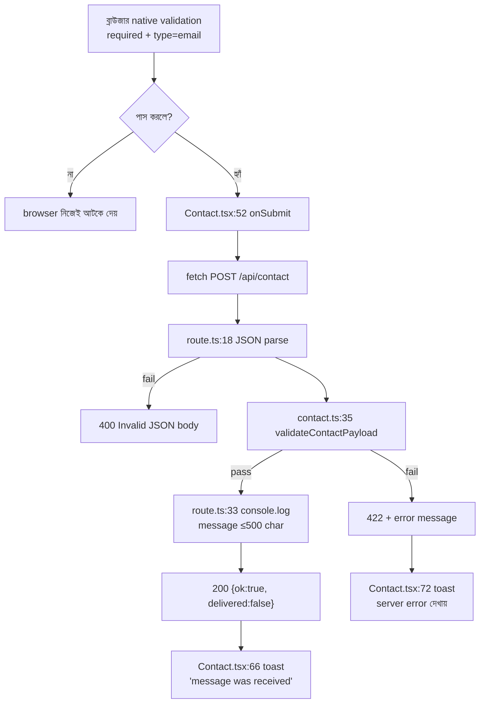
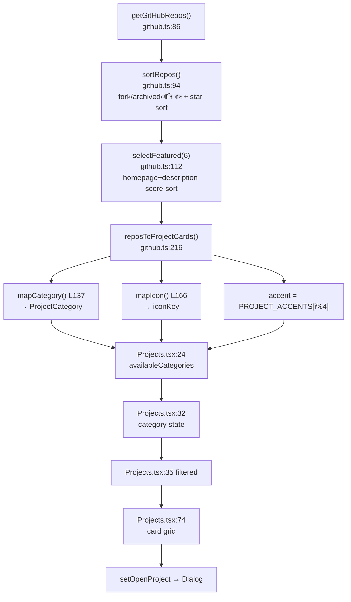
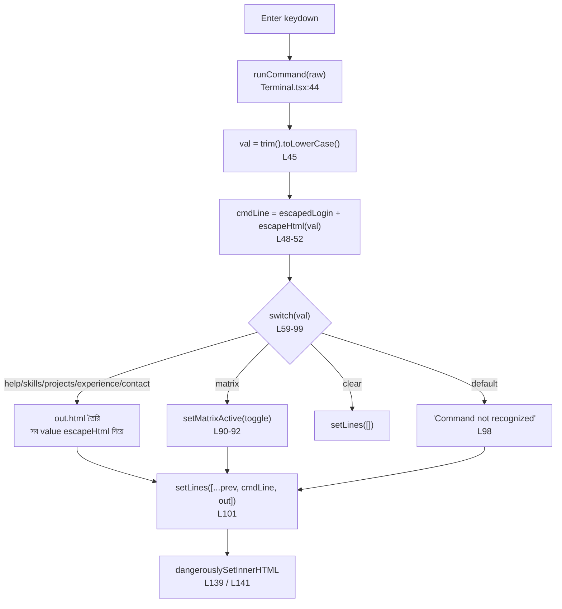
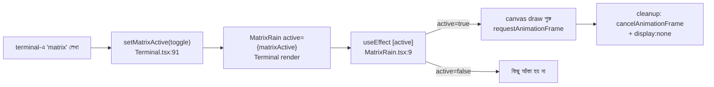

# DATA_FLOWS — my-portfolio

> প্রতিটি flow বর্তমান commit (`2fba326`) অনুযায়ী source code পড়ে trace করা।
> **বাস্তব আচরণ** ও **ভবিষ্যতের পরিকল্পনা** স্পষ্টভাবে আলাদা করা হয়েছে।

---

## Flow 1 — Homepage: GitHub → transform → UI

### ধাপে ধাপে

**ধাপ ১ — Page শুরু হয়**
`app/page.tsx:21` — `Home` একটি `async` **Server Component**। মানে এটি server-এ চলে, browser-এ নয়।

**ধাপ ২ — দুটো data call একসাথে**
```ts
const [profile, projects] = await Promise.all([
  getGitHubProfile(),
  getFeaturedProjects(6),
]);                              // app/page.tsx:22-25
```
`Promise.all` দুটো network call **সমান্তরাল** চালায় — দুটো শেষ হওয়ার জন্য অপেক্ষা করে, কিন্তু একটা শুরু হলে অন্যটাও চলে।

**ধাপ ৩ — GitHub থেকে profile**
`lib/github.ts:82` `getGitHubProfile()` → `lib/github.ts:52` `githubFetch()` →
`fetch("https://api.github.com/users/{GITHUB_USER}", { headers, next: { revalidate: 1800 } })`

- `GITHUB_USER` = `process.env.GITHUB_USER || "pappu116"` (L8)
- `headers` (L11-14): `Accept`, `X-GitHub-Api-Version: 2022-11-28`, `User-Agent`
- `GITHUB_TOKEN` থাকলে `Authorization: Bearer …` header যোগ হয় (L16-18)
- `revalidate: 1800` = **৩০ মিনিট cache** (L56)

**ধাপ ৪ — Project আসে**
`lib/github.ts:123` `getFeaturedProjects(6)` →
`getGitHubRepos()` (L86) → `githubFetch("/users/{USER}/repos?sort=stars&per_page=100&direction=desc")` →
`sortRepos()` (L94) → `selectFeatured()` (L112) → `reposToProjectCards()` (L216)

**ধাপ ৫ — Transform: raw → UI-ready**
```ts
const heroProfile = buildHeroProfile(profile, getGitHubUser());   // app/page.tsx:27
const { brandMain, brandAccent } = splitBrandName(heroProfile.name); // :28
const portraitSrc = resolvePortraitSrc();                          // :29
```
`lib/profile.ts:89` `buildHeroProfile` প্রতিটি field-এ fallback দেয়:

| Field | উৎস | Fallback |
|---|---|---|
| `name` | `profile.name` | `FALLBACK_PROFILE.name` ("Pappu Hasan") |
| `role` | `deriveRoleFromBio(bio)` (L60) | `FALLBACK_PROFILE.role` |
| `yearsOnGitHub` | `yearsSince(created_at)` (L79) | `0` |
| `avatar` | `profile.avatar_url` | placeholder URL |
| `twitterUrl` | `profile.twitter_username` | `null` |

**ধাপ ৬ — Render**
`app/page.tsx:31-59` — ১১টি component props হিসেবে data পায়।

### Flowchart



### Error / fallback আচরণ

| পরিস্থিতি | ফলাফল |
|---|---|
| GitHub 200 | Real data দেখায় |
| GitHub non-OK (403 rate limit, 404) | `console.warn` (L62) → `null` → **fallback profile** → page 200 |
| Network error | `console.warn` (L70) → `null` → fallback profile → page 200 |
| `public/` নেই | `resolvePortraitSrc()` → `null` → GitHub avatar ব্যবহার হয় |

**যাচাই করা হয়নি:** GitHub rate-limit আসলে কতবার ঘটে, এবং ৩০ মিনিটের `revalidate` cache browser refresh-এর সাথে কীভাবে interact করে — সেটা instrument করে দেখা হয়নি।

---

## Flow 2 — Contact form: browser → API → validation → toast

### ধাপে ধাপে

**ধাপ ১ — Browser-এর নিজস্ব validation (সবার আগে)**
`components/Contact.tsx` form-এর input-গুলো `required` এবং `type="email"`। তাই ভুল email-এ **browser নিজেই** submit আটকে দেয় — server-এ পৌঁছানোর আগেই।

**ধাপ ২ — Submit**
`components/Contact.tsx:52` `onSubmit`:
```ts
e.preventDefault();                              // L53
const data = Object.fromEntries(new FormData(form));  // L54
setSending(true);                                // L56
```

**ধাপ ৩ — API call**
```ts
const res = await fetch("/api/contact", {
  method: "POST",
  headers: { "Content-Type": "application/json" },
  body: JSON.stringify(data),
});                                               // L59-64
```

**ধাপ ৪ — Server: JSON parse**
`app/api/contact/route.ts:18-22` — body পড়তে ব্যর্থ হলে `400 {error: "Invalid JSON body."}`।

**ধাপ ৫ — Server: validation**
`app/api/contact/route.ts:25` → `lib/contact.ts:35` `validateContactPayload(payload)`:

| ধাপ | লাইন | পরীক্ষা | ফল |
|---|---|---|---|
| ১ | L36-38 | payload object কিনা (array/null/string reject) | `"Expected a JSON object."` |
| ২ | L41-45 | প্রতিটি field `string` কিনা | `Field "name" must be a string.` |
| ৩ | L47-52 | trim | — |
| ৪ | L54-61 | খালি কিনা | `All fields … are required.` |
| ৫ | L63-70 | length cap (`name` 120, `email` 200, `subject` 200, `message` 5000) | `Field "x" must be N characters or fewer.` |
| ৬ | L71-74 | email regex (L27) | `Email address looks invalid.` |

ব্যর্থ হলে route `422 {error}` ফেরত দেয় (`app/api/contact/route.ts:26-28`)।

**ধাপ ৬ — Server: log + response**
সফল হলে `app/api/contact/route.ts:33-41` console-এ লেখে, তারপর L43:
```ts
return NextResponse.json({ ok: true, delivered: false });
```

**ধাপ ৭ — UI feedback**
`components/Contact.tsx`:
- `res.ok` (L66) → `setSent(true)` + toast "Thanks! Your message was received." + `form.reset()`
- `!res.ok` (L72-79) → server-এর `body.error` পড়ে toast-এ দেখায়
- `catch` (L81-82) → "Network error — please try again."

**ধাপ ৮ — Toast সরে যায়**
`showToast` (L41-46) — ৪২০০ms পরে toast সরায়। Timer `timers` ref-এ (L31) জমা হয় এবং unmount-এর সময় clear হয় (L33-38)।

### Flowchart



### বাস্তবতা বনাম পরিকল্পনা

| বিষয় | বাস্তব (এখন) | ভবিষ্যতের পরিকল্পনা |
|---|---|---|
| Delivery | ❌ **কোনো email পাঠানো হয় না** — শুধু `console.log` | একটি email provider (Resend/SES) + `deliverMessage()` helper, তারপর `delivered: true` |
| Response | `{ok: true, delivered: false}` (route.ts:43) | `{ok: true, delivered: true}` |
| UI copy | "Message Received!" (Contact.tsx:269) | provider যুক্ত হলে "Sent!" বলা যাবে |
| Rate limit | ❌ নেই | চাইলে যোগ করা যাবে |
| Spam হিস্ট্রি | ❌ নেই | honeypot field যোগ করা যাবে |

`app/api/contact/route.ts:7-15`-এর comment-এ এটা স্পষ্ট লেখা আছে।

---

## Flow 3 — Projects: repo data → sort → category → UI

### ধাপে ধাপে

**ধাপ ১ — সব repo আসে**
`lib/github.ts:86` `getGitHubRepos()` → `/users/{USER}/repos?sort=stars&per_page=100&direction=desc`

**ধাপ ২ — প্রথম filter + sort**
`lib/github.ts:94` `sortRepos()` — যা বাদ দেয়:
- fork repo (`r.fork`)
- archived repo (`r.archived`)
- নিজের প্রতিবেশী repo-র নামে match (L100)
- খালি repo (`(r.size ?? 0) > 0`, L101)

তারপর sort: **star সংখ্যা desc**, তারপর `pushed_at` desc (L103-107)।

**ধাপ ৩ — দ্বিতীয় filter + sort**
`lib/github.ts:112` `selectFeatured()` — comment-এ (L110-111) বলা আছে "deployed projects first, then the most recently pushed":

score = homepage আছে (`+2`) + description আছে (`+1`) (L115-116)

এরপর `pushed_at` desc, তারপর `.slice(0, limit)` (L120)।

> **⚠️ দুটো sort আলাদা জায়গায়:** `sortRepos` star-এর উপর sort করে, কিন্তু `selectFeatured` সেটা **আবার** homepage/description score-এর উপর sort করে — ফলে homepage-এর জন্য star ordering বাতিল হয়ে যায়। দুটোর নিজস্ব কারণ আছে (`getGitHubRepos` সরাসরি API route-এও ব্যবহৃত, সেখানে star order বোঝায়), কিন্তু একসাথে পড়লে বিভ্রান্তিকর।

**ধাপ ৪ — Card-এ রূপান্তর**
`lib/github.ts:216` `reposToProjectCards()`:
- `title` = `titleize(repo.name)` (L130-135) — "my-awesome-project" → "My Awesome Project"
- `category` = `mapCategory(repo)` (L137) — keyword matching
- `iconKey` = `mapIcon(repo)` (L166) — language/keyword থেকে
- `accent` = `PROJECT_ACCENTS[index % 4]` — গোলাকারে ৪টি gradient
- `tech` = language আগে, তারপর topics, **সর্বোচ্চ ৫টা**
- `fullDescription` = `mapFullDescription()` — repo description + meta info

**ধাপ ৫ — কোন tab দেখাবে**
`components/Projects.tsx:24` `availableCategories`:
```ts
const used = new Set(projects.map((project) => project.category));
return FILTERS.filter((filter) => filter.id === "all" || used.has(filter.id));
```
অর্থাৎ **যে category-তে কোনো repo নেই, সেই tab দেখায় না।**

`FILTERS` (L13): `all` → "ALL", `saas` → "SaaS", `ecommerce` → "E-Commerce", `mobile` → "Mobile Apps", `webapp` → "Web Apps", `project` → "Other"

**ধাপ ৬ — Filter + render**
`components/Projects.tsx:32` `category` state (`"all" | ProjectCategory`) → L35 `filtered` → L74-77 map করে `<motion.div key={project.id}>`।

**ধাপ ৭ — Detail modal**
"Details & Architecture" button → `setOpenProject(project)` → Radix `Dialog` খোলে → `openProject.fullDescription` দেখায়।

### Flowchart



### সীমাবদ্ধতা

- `mapCategory` (L137) **keyword heuristic** — "E Comerce" (বানান ভুল) `ecommerce` match করে না, তাই `webapp` হয়েছে
- `mapIcon` (L166) একইভাবে heuristic
- `PROJECT_ACCENTS` চারটি — repo বেশি হলে একই gradient বারবার আসবে

---

## Flow 4 — Terminal: input → command → output

### ধাপে ধাপে

**ধাপ ১ — Input**
`components/Terminal.tsx` input-এর `onKeyDown`-এ Enter চাপলে `runCommand(value)` চলে, তারপর `setValue("")`।

**ধাপ ২ — Normalize**
```ts
const val = raw.trim().toLowerCase();   // Terminal.tsx:45
if (!val) return;                      // L46
```
খালি বা শুধু whitespace → কিছু হয় না।

**ধাপ ৩ — Command line তৈরি**
```ts
html: `<span class="text-emerald-400">${escapedLogin}@${escapedLogin}</span>:…$ ${escapeHtml(val)}`
```
(L48-52) — `escapedLogin` আগেই escape করা (L25), `val` escape করা।

**ধাপ ৪ — Switch**
`Terminal.tsx:59-99` — ৭টি case:

| Command | Line | কী দেখায় |
|---|---|---|
| `help` | L61 | সব command-এর তালিকা |
| `skills` | L64-70 | skill name + category + level |
| `projects` | L72-78 | project title + description + star |
| `experience` | L80-85 | career timeline |
| `contact` | L87-88 | GitHub URL, email, নাম |
| `matrix` | L90-92 | Matrix effect toggle + confirmation |
| `clear` | L94-97 | screen মুছে দেয় |
| default | L98 | "Command not recognized" |

**ধাপ ৫ — Render**
```ts
setLines((prev) => (out ? [...prev, cmdLine, out] : [...prev, cmdLine]));  // L101
```
তারপর `dangerouslySetInnerHTML` (L139, L141) দিয়ে HTML হিসেবে বসানো।

### Escaping — কেন গুরুত্বপূর্ণ

`profileUrl`, `githubEmail`, `name`, `login` — সব GitHub API থেকে আসা value, অর্থাৎ বাইরের নিয়ন্ত্রণে। এগুলো `escapeHtml` দিয়ে escape করা (L67, 75, 82, 87, 98)।

**Live যাচাই করা হয়েছে:** terminal-এ `` লিখে Enter — output-এ text হিসেবে দেখায়, **০টি injected tag**।

> **⚠️ সতর্কতা:** `dangerouslySetInnerHTML` ব্যবহার করলে React-এর স্বয়ংক্রিয় escaping বন্ধ হয়ে যায়। তাই নতুন dynamic value যোগ করার সময় **অবশ্যই** `escapeHtml` ব্যবহার করতে হবে — নইলে XSS সম্ভব।

### Flowchart



---

## Flow 5 — Matrix effect: terminal ↔ component

### ধাপে ধাপে

**ধাপ ১ — Command**
`components/Terminal.tsx:90-92`:
```ts
case "matrix":
  setMatrixActive((v) => !v);
  out.html = `<span class="text-emerald-400">Matrix visual easter egg toggled!</span>`;
```

**ধাপ ২ — State → prop**
`Terminal` render-এর শেষে: `<MatrixRain active={matrixActive} />`

**ধাপ ৩ — Effect শুরু/বন্ধ**
`components/MatrixRain.tsx:9` `useEffect(..., [active])`:
- `active === false` হলে effect থেকে ফিরে যায় (L11) — কিছু আঁকে না
- `active === true` হলে canvas size ঠিক করে, random characters নামায়, `requestAnimationFrame` দিয়ে আঁকা শুরু করে
- cleanup-এ `cancelAnimationFrame(raf)` (L46) এবং `canvas.style.display = "none"`

**ধাপ ৪ — CSS**
`app/globals.css` — `.matrix-canvas` class: `display: none`, `position: fixed`, `z-index: 90`, `pointer-events: none`। JavaScript `display: "block"` করে সেটিকে দৃশ্যমান করে।

### Mermaid



> **`matrix` command-টি শুধু terminal-এর ভেতরে কাজ করে**, পুরো পেজে নয় — `MatrixRain` component-টি `Terminal`-এর ভেতরেই render হয় (`Terminal.tsx` শেষে)।

---

## সারসংক্ষেপ — কোন flow-এ সমস্যা হলে কোথায় যাবেন

| সমস্যা | সম্ভাব্য কারণ | দেখুন |
|---|---|---|
| Hero-তে নাম/stats ভুল | transform ভুল | `lib/profile.ts` |
| Project দেখাচ্ছে না | category বা selection | `lib/github.ts` L94, L112, L137 |
| Project tab দেখাচ্ছে না | filter list | `components/Projects.tsx` L13, L24 |
| Form submit হচ্ছে না | validation | `lib/contact.ts` L35 |
| Form error দেখাচ্ছে না | response handling | `components/Contact.tsx` L66-82 |
| Email আসছে না | **delivery implement করা নেই** | `app/api/contact/route.ts` L7-15, L43 |
| Terminal-এ HTML দেখাচ্ছে | escape করা হয়নি | `lib/html.ts` L24 |
| Page ফাঁকা / GitHub data নেই | API fail | `lib/github.ts` L59-75 |
