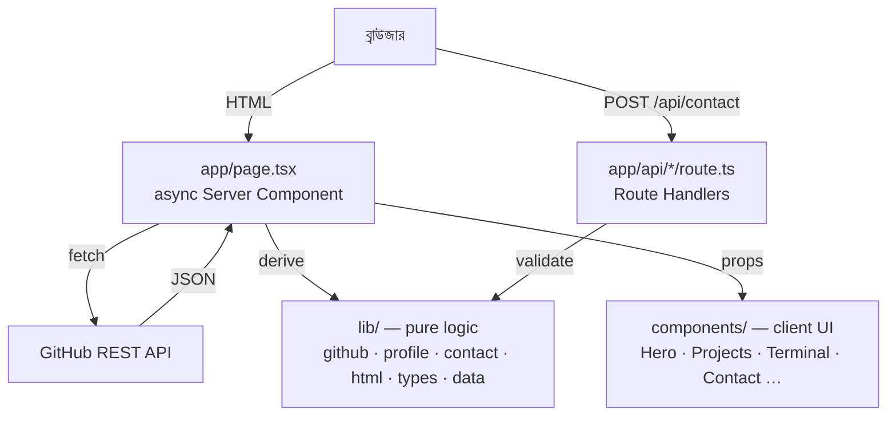

# PROJECT_OVERVIEW — my-portfolio

> এই ডকুমেন্টটি বাংলায় লেখা, কিন্তু code identifier, file path ও command ইংরেজিতেই রাখা হয়েছে — যাতে আপনি সরাসরি source code-এর সাথে মিলিয়ে পড়তে পারেন।

## ১. এই অ্যাপটি কী করে

এটি একটি **personal developer portfolio website** — dark neon / cyberpunk aesthetic-এ তৈরি, এক পাতায়।

পেজে ১১টি section আছে:

| Section | Component | Content কোথা থেকে আসে |
|---|---|---|
| Particle background | `ParticleBackground` | সম্পূর্ণ code-drawn canvas animation |
| Navbar | `Navbar` | brand name → GitHub থেকে |
| Hero | `Hero` | GitHub (নাম, ছবি, stats, role) |
| Code showcase | `CodeShowcase` | GitHub (নাম, role, location) |
| About | `About` | সম্পূর্ণ static (`lib/data.ts` নয়, file-internal) |
| Skills | `Skills` | `lib/data.ts` → `SKILLS` |
| Projects | `Projects` | GitHub (repositories) |
| Terminal | `Terminal` | GitHub + `lib/data.ts` |
| Experience | `Experience` | `lib/data.ts` → `TIMELINE` |
| Contact | `Contact` | GitHub (profileUrl, email, twitter) |
| Footer | `Footer` | GitHub (নাম, profile URL) |

**মূল বৈশিষ্ট্য:** name, ছবি, bio, stats, project list — সবই **live GitHub API** থেকে আসে। `GITHUB_USER` env variable বদলালে পুরো সাইটের content বদলে যায়, কোড ছুঁতে হয় না।

## ২. Technology stack

সবগুলো `package.json` থেকে verified (`package.json:13-35`):

| Technology | Version | কোথায় ব্যবহার হয় |
|---|---|---|
| Next.js (App Router) | `^15.1.6` | `app/` — routing, API routes, server rendering |
| React | `^19.0.0` | সব component |
| TypeScript | `^5.7.3` (strict) | `tsconfig.json:7` → `"strict": true` |
| Tailwind CSS | `^3.4.17` | styling; custom tokens `tailwind.config.ts` |
| Framer Motion | `^12.0.0` | `components/` — animation, `whileInView` |
| react-icons | `^5.4.0` | `IconMap.tsx`, `Experience.tsx`, `Terminal.tsx` সহ |
| Radix UI Dialog | `^1.1.6` | `components/ui/dialog.tsx` — modal |
| clsx + tailwind-merge | `^2.1.1`, `^3.0.1` | `lib/utils.ts` → `cn()` |
| Vitest | `^5.0.5` (dev) | `lib/__tests__/` — ৫১টি test case |

**বিশেষভাবে নেই:** কোনো ESLint config নেই, কোনো test framework নেই (শুধু Vitest), কোনো UI library নেই (Radix ছাড়া)।

## ৩. Architecture — তিন স্তর

```
app/        →  routing ও data fetching (Server Component)
components/ →  UI (প্রায় সবগুলো "use client")
lib/        →  pure logic ও static data (কোনো React নেই)
```

**এই বিভাজনের সুবিধা:** `lib/`-এর কোনো function browser-এর জন্য লেখা নয়, তাই সেগুলো সহজে test করা যায় — এবং `lib/__tests__/`-এ ঠিক সেগুলোই test করা হয়েছে।

**নিয়ম:** component কখনো GitHub API কে সরাসরি call করে না। সব data `app/page.tsx` fetch করে, `lib/`-এর মাধ্যমে transform করে, তারপর props হিসেবে component-এ পাঠায়।

## ৪. Architecture diagram



### Homepage কীভাবে assemble হয়

`app/page.tsx:21` থেকে শুরু:

```ts
const [profile, projects] = await Promise.all([
  getGitHubProfile(),
  getFeaturedProjects(6),
]);                              // app/page.tsx:22-25

const heroProfile = buildHeroProfile(profile, getGitHubUser());  // :27
const { brandMain, brandAccent } = splitBrandName(heroProfile.name); // :28
const portraitSrc = resolvePortraitSrc();                          // :29
```

তারপর ১১টি component JSX-এ সাজানো (`app/page.tsx:31-59`)।

`Promise.all` ব্যবহার করার কারণ: profile আর projects দুটোই network call — দুটো একসাথে শুরু হলে মোট সময় কম লাগে (parallel)।

## ৫. এখন যা কাজ করে ✅

- Homepage সম্পূর্ণ GitHub data দিয়ে render হয় (name, avatar, stats, ৬টি featured project)
- Project filter tabs কাজ করে — শুধু যে category-তে repo আছে সেই tab দেখায়
- Terminal-এর ৭টি command কাজ করে: `help`, `skills`, `projects`, `experience`, `contact`, `matrix`, `clear`
- Contact form validate হয়, server-এ log হয়, এবং UI-তে toast দেখায়
- GitHub API ব্যর্থ হলেও **পেজ ভাঙে না** — static fallback দেখায়
- ৫১টি unit test + typecheck + production build — সব pass করে

## ৬. যা অসম্পূর্ণ বা সীমাবদ্ধ ⚠️

এগুলো গুরুত্বপূর্ণ — ডকুমেন্টেশনে সৎভাবে উল্লেখ করা দরকার:

### ৬.১ Contact form email **পাঠায় না** 🔴
`app/api/contact/route.ts:43`:
```ts
return NextResponse.json({ ok: true, delivered: false });
```
`delivered: false` — অর্থাৎ message **কোথাও deliver হয় না**, শুধু server console-এ `console.log` হয় (`app/api/contact/route.ts:33-41`)। File-এর comment-এ (L7-15) স্পষ্ট লেখা আছে কোনো email provider নেই।

UI তাই "Message Received!" দেখায় (`components/Contact.tsx:269`), "Sent!" নয় — এটা ইচ্ছাকৃত, সৎ রাখার জন্য।

**ভবিষ্যতে যা লাগবে:** একটি email provider (Resend / SES), একটি `deliverMessage()` helper, এবং provider confirm করলে `delivered: true` ফেরত দেওয়া।

### ৬.২ `public/` directory নেই 🟡
`lib/portrait.ts:24` `resolvePortraitSrc()` — `public/portrait.png` (বা `.webp`/`.jpg`/`.jpeg`) খোঁজে। কিন্তু repo-তে **`public/` folder-ই নেই** (verified), তাই এই function **সবসময় `null` ফেরত দেয়** এবং hero-তে সবসময় GitHub avatar দেখায়।

`README.md:66`-এ এই feature documented — ব্যবহার করতে হলে আগে `public/` folder বানাতে হবে।

### ৬.৩ GitHub response validate হয় না 🟡
`lib/github.ts:66`:
```ts
return (await res.json()) as T;
```
`as T` হলো TypeScript-এর type assertion — এটা runtime-এ কিছু **যাচাই করে না**। GitHub যদি আকস্পেক্টে response বদলায়, ভুল data চুপচাপ ঢুকে যাবে। আলাদা schema validation নেই।

### ৬.৪ Icon key ভুল হলে নিঃশব্দে বদলে যায় 🟡
`components/IconMap.tsx:55`:
```ts
const Cmp = (iconKey && ICON_MAP[iconKey]) || FaLaptopCode;
```
`Skill.icon` ও `ProjectCard.iconKey` টাইপটা `string` (union নয়) — তাই `lib/data.ts` বা `lib/github.ts`-এ একটা বানান ভুল icon key লিখলে compile error হবে না, শুধু default icon দেখাবে।

### ৬.৫ `repos` API route error signal দেয় না 🟡
`app/api/github/repos/route.ts:6-9` — GitHub fail হলে `{projects: []}` ফেরত দেয় (২০০ status-এ)। বিপরীত `app/api/github/profile/route.ts:10-14` একই পরিস্থিতিতে `503` দেয়।

### ৬.৬ Contact API-তে rate limit নেই 🟡
Spam ঠেকাতে কোনো rate limiting বা honeypot নেই। একই সাথে server log-এ submitter-এর name, email, subject, message (≤৫০০ char) লেখা হয় — `README.md`-এ এটা documented।

### ৬.৭ `.env` file gitignore নয় 🟡
`.gitignore:23` শুধু `.env*.local` ignore করে। `GITHUB_TOKEN`-এর জন্য `.env` ব্যবহার করলে সেটা accidentally commit হতে পারে। **এখন কোনো `.env` file নেই** (verified)।

### ৬.৮ ESLint নেই 🟡
`components/Hero.tsx:52` ও `:167`-এ `eslint-disable` comment আছে, কিন্তু repo-তে ESLint config বা dependency নেই — তাই comment-গুলো কার্যকর নয়, শুধু documentation হিসেবে কাজ করে।

## ৭. কীভাবে চালাবেন

```bash
npm install     # dependency install
npm run dev     # development server → http://localhost:3000
```

### সব script (`package.json:5-12`)

| Script | কী করে |
|---|---|
| `npm run dev` | Development server চালু করে |
| `npm run build` | Production build তৈরি করে |
| `npm start` | Production build serve করে |
| `npm run typecheck` | `tsc --noEmit` — TypeScript error খোঁজে, কোনো file লেখে না |
| `npm test` | Vitest একবার চালায় (51 test) |
| `npm run test:watch` | Vitest watch mode — code বদলালে নিজে থেকে test চালায় |

### Environment variables

দুটোই optional — ছাড়া দিলেও সাইট চলে:

| Variable | কাজ | Default |
|---|---|---|
| `GITHUB_USER` | কোন GitHub account-এর content দেখাবে | `pappu116` (`lib/github.ts:8`) |
| `GITHUB_TOKEN` | API rate limit বাড়ায় | নেই (`lib/github.ts:16-18`) |

> `GITHUB_TOKEN` কখনো code-এ বা commit-এ লিখবেন না — শুধু env variable হিসেবে দিন।

## ৮. পরবর্তী ধাপ

- কোন file কী করে → [`FILE_MAP.md`](./FILE_MAP.md)
- data কীভাবে চলে → [`DATA_FLOWS.md`](./DATA_FLOWS.md)
- কোন term কী মানে → [`CODE_GLOSSARY.md`](./CODE_GLOSSARY.md)
- কোন order-এ পড়বেন → [`LEARNING_PATH.md`](./LEARNING_PATH.md)
